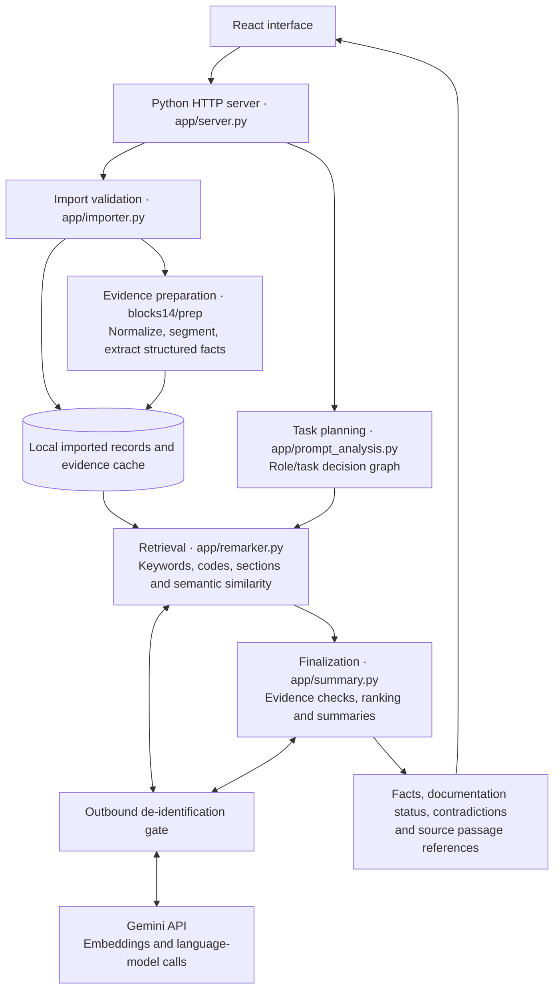

# Clinical Summary Desk

AIM Hackathon · Track 1: Clinical Documentation.
Enter a clinical role and task to find relevant patient facts, linked source passages, and contradictions.

## Setup

### Option 1: Open the Vercel demo (recommended)

**Start here: [Open Clinical Summary Desk](https://aimtoru-eight.vercel.app)** — no local installation required.

The hosted demo runs roughly the same version; its interface and available features may differ from the latest repository build. For a reproducible run of the repository version, use the local setup below. The jury guide below describes that local build.

### Option 2: Run locally

With **Python 3.12+**, **Node.js 22+** (including npm), and Git installed:

```sh
git clone https://github.com/TeoVisnovsky/aimhackathon.git
cd aimhackathon
python run.py
```

**Open Gemini keys in the app and paste the keys from the submission form:** one primary key and up to two optional backups. Click **Save Gemini keys**, then import the patient. Keys are masked and saved locally, excluded from Git. The backend tries another key on quota or key rejection; keys belonging to the same Google project share quota. Dependencies and the frontend build are handled automatically.

On macOS/Linux use `python3` if needed. The first run installs dependencies and builds the interface; setup and Gemini requests need internet access. Open **http://127.0.0.1:8000** when the server says `ready`. Stop with **Ctrl+C**.

Later starts: `python run.py --skip-setup`. To replace keys, open **Gemini keys** on the search screen. If a patient is already loaded, restart the app after saving. Terminal configuration is also available: `python run.py --skip-setup --configure-keys`. After pulling changes, run `python run.py` again. For a different port, add `--port 8001`.

## Jury guide

1. Click **Import patient folder** and select the supplied patient directory containing `patient.json` and `documents/`, not the entire challenge repository. No challenge data is included here.
2. Import starts processing immediately. Write your role and task below while it runs; the assessment button becomes available when import finishes. The first import builds the Gemini search index; quota limits can delay indexing.
3. Enter your role and task, or paste a challenge situation's title and description, and click **Generate assessment**.
4. Read the relevant facts and documentation status. Click a linked fact for its original passage; open a contradiction to compare its sources.
5. Use **New search** for another situation. The last imported patient is selected automatically; no name or date of birth entry is needed. Switch English/German in the header.

Imports are stored locally in ignored `backend/.cache/imports/` and survive restarts. A fresh clone starts without a patient. Use only synthetic data. Never commit patient folders, caches, prepared evidence, or patient-containing reports.

## Architecture and models

Gemini powers semantic retrieval (`gemini-embedding-001`) and checked ranking/summary calls (`gemini-flash-lite-latest`). Python rules build source-linked evidence during import (`blocks14/prep`). A role/task decision graph selects questions; the backend retrieves passages, checks polarity and chronology, and calculates supported values (`backend/app`). React displays results and citations (`frontend`). The Python server serves both the built interface and API.

Cloud requests pass through the de-identification gate. The jury launcher selects Gemini; no Claude or Ollama configuration is needed. If Gemini is unavailable or rate-limited, the backend can temporarily fall back to keyword retrieval and templates; a configured key does not guarantee that every request uses a model. Import extraction remains rules-based, so unsupported narrative facts may be missed. The supplied record is evaluated locally; no patient-containing reports are published. This prototype does not claim all challenge metrics are satisfied.

### Backend architecture

The diagrams describe the local build in this repository. Imported files and API keys stay outside Git; selected clinical text is sent to Gemini through the outbound de-identification gate.



### How an assessment works

Import begins as soon as the user selects the patient folder, so preparation can run while they write the task. The app retains source passage references throughout the pipeline so a result can be opened in its original document.

```mermaid
sequenceDiagram
    actor Jury
    participant UI as React interface
    participant API as Python backend
    participant Prep as Import and indexing
    participant Model as Gemini via de-identification gate
    Jury->>UI: Select patient folder
    UI->>API: POST /api/import
    API->>Prep: Validate and store files; prepare evidence
    par Prepare retrieval
        Prep->>Model: Request document embeddings
        Model-->>Prep: Embeddings or API failure
    and Write the task
        Jury->>UI: Enter role and clinical task
    end
    Prep-->>API: Searchable record and processing status
    API-->>UI: Import confirmation and warnings
    Note over API,Prep: If embeddings are delayed, keyword search is available<br/>and semantic indexing continues in the background.
    Jury->>UI: Generate assessment
    UI->>API: POST /api/assess
    API->>API: Select questions using the decision graph
    API->>API: Retrieve passages; check polarity, dates and evidence
    API->>Model: Check and summarize retrieved evidence
    Model-->>API: Model output or API failure
    API->>API: Validate claims and references; use templates if needed
    API-->>UI: Results, citations, contradictions and processing status
    Jury->>UI: Open a citation or contradiction
    UI-->>Jury: Display original source passages
```

## Development checks

Use the Python interpreter in `backend/.venv` (`Scripts/python` on Windows; `bin/python` elsewhere):

```sh
cd backend
.venv/Scripts/python -m pytest -q
cd ../blocks14
../backend/.venv/Scripts/python -m pytest tests -q
cd ../frontend
npm test
npm run build
npm run lint
```

Based on the team implementation in [AIMhackathonTORU](https://github.com/ProgramHamza/AIMhackathonTORU). This repository contains the import-first jury build.
